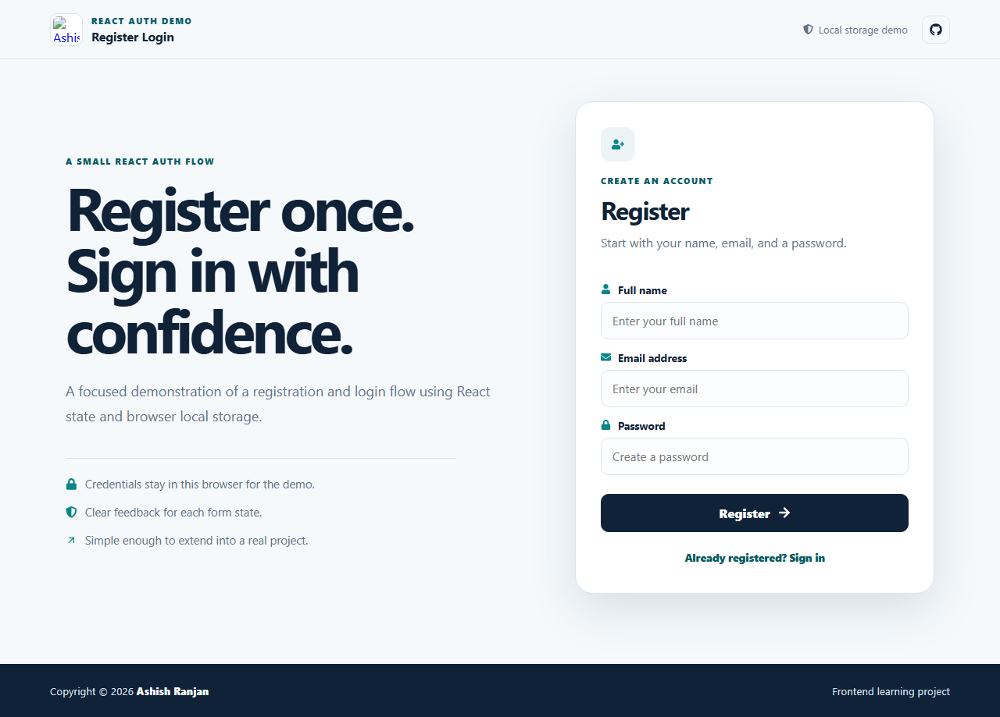

# React Register Login

A responsive front-end demo of registration and login interactions, with input values held in React memory only.



## Features

- Registration form with name, email, and password fields.
- In-memory demo sign-in validation; data disappears when the page reloads.
- Clear form error, success, and signed-in states.
- Fixed responsive header with local branding.
- Icon-only repository footer and accessible form labels.
- No server requests and no credentials saved to browser storage.

## Tech stack

React, Create React App, CSS, and React Icons.

This is a UI exercise, not an authentication system. Use fictional details only. Demo credentials exist only in page memory and are never sent to a server or written to local storage.

## Run locally

```bash
npm install
npm start
```

Create a production build with `npm run build`. Deploy to GitHub Pages with `npm run deploy`.

## Live

[Open the live project](https://a2rp.github.io/reactjs_registerlogin/)

## Links

- Portfolio: [https://www.ashishranjan.net](https://www.ashishranjan.net)
- GitHub: [https://github.com/a2rp](https://github.com/a2rp)
- CodePen: [https://codepen.io/ash1198](https://codepen.io/ash1198)
- LinkedIn: [https://www.linkedin.com/in/aashishranjan](https://www.linkedin.com/in/aashishranjan)
- Facebook: [https://www.facebook.com/theash.ashish/](https://www.facebook.com/theash.ashish/)
- YouTube: [https://www.youtube.com/@ashishranjan-ashz?sub_confirmation=1](https://www.youtube.com/@ashishranjan-ashz?sub_confirmation=1)
- Email: [ash.ranjan09@gmail.com](mailto:ash.ranjan09@gmail.com)

## Support

- Support: [https://a2rp-donation-page.netlify.app/](https://a2rp-donation-page.netlify.app/)
- Buy Me a Coffee: [https://buymeacoffee.com/a2rp](https://buymeacoffee.com/a2rp)
- Patreon: [https://patreon.com/a2rp](https://patreon.com/a2rp)
